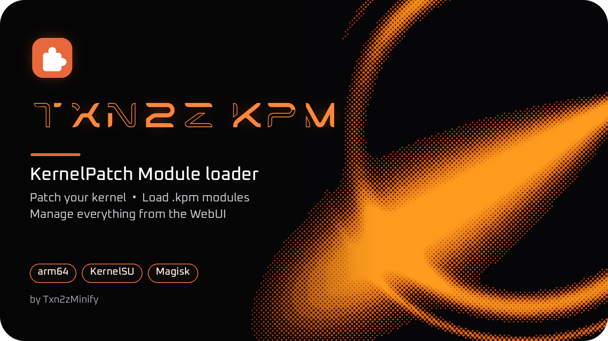
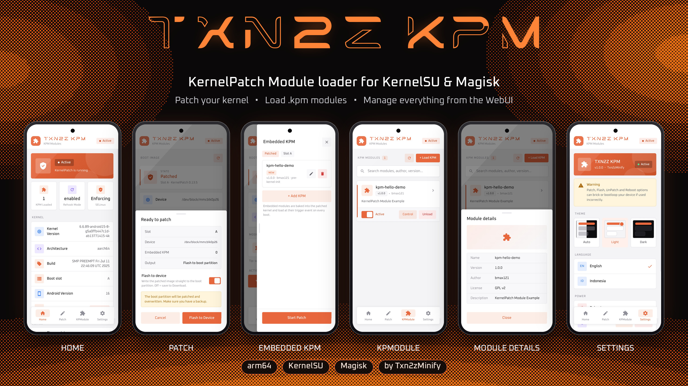

 

[Preview](#preview) &nbsp;|&nbsp; [Features](#features) &nbsp;|&nbsp; [Install](#installation) &nbsp;|&nbsp; [Requirements](#requirements) &nbsp;|&nbsp; [Credits](#credits)

---

## Preview

## Features

| | |
|---|---|
| **Patch / UnPatch** | Patch your boot image with KernelPatch, flash directly or save to Download |
| **KPM Loader** | Load and unload `.kpm` modules with custom arguments |
| **Embed KPM** | Embed modules into the kernel image, loaded on every boot |
| **Auto Load** | Saved modules are loaded automatically at boot |
| **Rehook Syscall** | Enable or disable with one tap |
| **Reboot Menu** | System, Recovery, Bootloader, Download, EDL |
| **Device Info** | Kernel, Android version, SELinux, fingerprint |
| **Themes & Language** | Light / dark theme, English and Indonesian |
| **Safe Installer** | Checks root, arch, kernel, KALLSYMS and binaries before installing |

## Requirements

- Magisk or KernelSU (APatch is **not** supported)
- arm64 device
- Kernel 3.18 to 6.12
- `CONFIG_KALLSYMS=y` enabled
- Kernel without built-in KPM (`CONFIG_KPM` must be off)
- A WebUI app: KSUWebUIStandalone for Magisk, or the built-in WebUI on KernelSU

## Installation

1. Download the zip from [Releases](https://github.com/Txn2z/TXN2Z-KPM/releases/latest).
2. Flash it in Magisk or KernelSU.
3. Reboot.
4. Open the WebUI with the **Action** button.
5. Patch your kernel and reboot again.
6. Load your `.kpm` modules from the **KPModule** tab.

> [!WARNING]
> Patching a kernel can cause a bootloop if done wrong. Always back up your boot image first. Use at your own risk.

## Roadmap

- [x] WebUI for Magisk and KernelSU
- [ ] APK version (maybe, if I have free time)

## Credits

The module is made by **Txn2zMinify**. The binaries are **not made by me**. All credit goes to the original authors:

| Component | Author |
|---|---|
| KernelPatch (`kpimg`, `kptools`, `kpatch`) | [bmax121](https://github.com/bmax121/KernelPatch) |
| Boot patch scripts | [APatch](https://github.com/bmax121/APatch) by bmax121 |
| `magiskboot` | [topjohnwu](https://github.com/topjohnwu/Magisk) (Magisk) |
| WebUI support | [KernelSU](https://github.com/tiann/KernelSU), [KsuWebUIStandalone](https://github.com/5ec1cff/KsuWebUIStandalone) |

If you own any of these and want something changed or removed, please open an issue.

Made by Txn2zMinify

